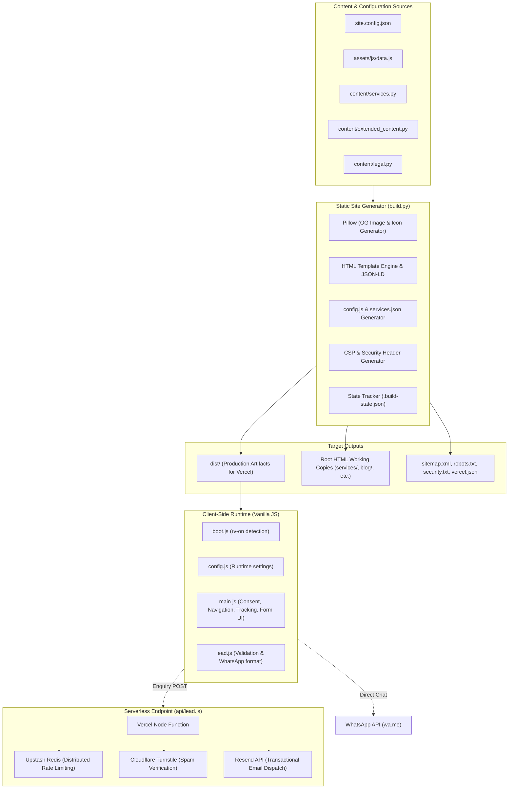
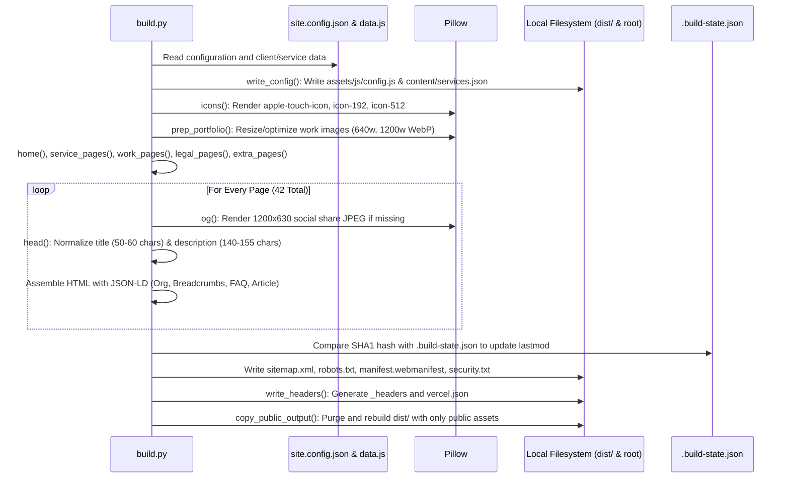
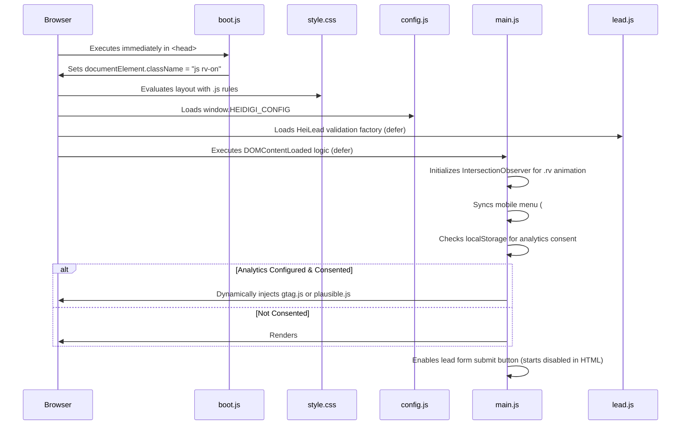
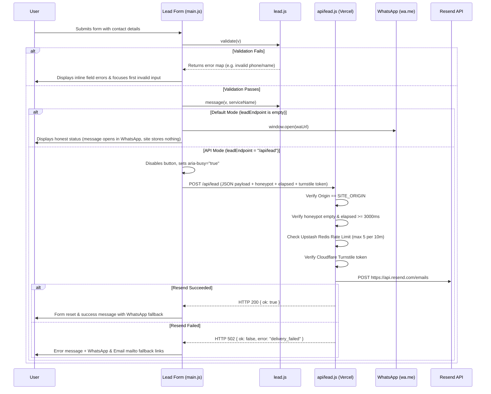
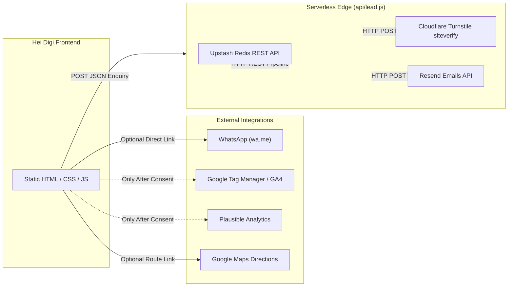

# Repository Reconnaissance Report: Hei Digi Digital Marketing

**Target Repository:** `c:/Users/cshar/Downloads/HEIDIGI-DIGITAL-MARKETING`  
**Protocol:** Verified Repository Reconnaissance Protocol (`/goal`)  
**Commit Inspected:** `bb8bb09` (`Remove buildCommand from vercel.json`)  
**Evaluation Date:** October 16, 2026  
**Status:** Verification complete. Zero application code modifications made.

---

## 1. Executive Overview

**Hei Digi** is a production-grade, privacy-first static website and serverless lead generation platform for a digital marketing agency located in Tirupati, Andhra Pradesh, India.

The project is built around a custom Python-based static site generator ([`build.py`](file:///c:/Users/cshar/Downloads/HEIDIGI-DIGITAL-MARKETING/build.py)) and a Vercel Node.js serverless API function ([`api/lead.js`](file:///c:/Users/cshar/Downloads/HEIDIGI-DIGITAL-MARKETING/api/lead.js)). It features zero runtime client framework dependencies, delivering vanilla HTML5, CSS3, and ES6 JavaScript.

### Key Capabilities
- **Static Site Generation (SSG):** Generates 42 HTML pages (41 indexable pages + 1 `404.html`) along with dynamic Open Graph social share images (1200x630 JPEG generated via Pillow), XML sitemaps, `robots.txt`, `security.txt`, and Web App Manifests.
- **Enterprise Security Posture:** Ships with a strict Content Security Policy (`default-src 'self'`), zero inline scripts or inline styles, HTTP Strict Transport Security (HSTS), Subresource Integrity cache busting (`?v=<sha1>`), and security headers configured for both Vercel ([`vercel.json`](file:///c:/Users/cshar/Downloads/HEIDIGI-DIGITAL-MARKETING/vercel.json)) and Cloudflare/Netlify ([`_headers`](file:///c:/Users/cshar/Downloads/HEIDIGI-DIGITAL-MARKETING/_headers)).
- **Dual-Mode Enquiry Handling:**
  - *Default Mode:* Client-side validation in [`assets/js/lead.js`](file:///c:/Users/cshar/Downloads/HEIDIGI-DIGITAL-MARKETING/assets/js/lead.js) constructs a formatted message and redirects directly to WhatsApp (`wa.me`), requiring zero database storage or backend infrastructure.
  - *API Mode:* Optional serverless endpoint ([`api/lead.js`](file:///c:/Users/cshar/Downloads/HEIDIGI-DIGITAL-MARKETING/api/lead.js)) with distributed rate limiting (Upstash Redis REST pipeline with in-memory fallback), Cloudflare Turnstile anti-bot verification, payload sanitization, honeypot fields, submission velocity checks (`elapsed < 3000ms`), and transactional email dispatch via Resend.
- **Privacy & Analytics Architecture:** Compliant with India's Digital Personal Data Protection Act (DPDPA 2023) draft guidance; GA4 / Plausible scripts stay completely unmounted until explicit consent is recorded in `localStorage`.
- **Exhaustive Automated Verification:** Ships with a custom 3,063+ assertion static audit engine ([`tools/audit.py`](file:///c:/Users/cshar/Downloads/HEIDIGI-DIGITAL-MARKETING/tools/audit.py)), multi-mode configuration test ([`tools/test_build_modes.py`](file:///c:/Users/cshar/Downloads/HEIDIGI-DIGITAL-MARKETING/tools/test_build_modes.py)), unit test suites ([`tools/test_lead.js`](file:///c:/Users/cshar/Downloads/HEIDIGI-DIGITAL-MARKETING/tools/test_lead.js), [`tools/test_api.js`](file:///c:/Users/cshar/Downloads/HEIDIGI-DIGITAL-MARKETING/tools/test_api.js)), link crawler ([`tools/crawl_links.py`](file:///c:/Users/cshar/Downloads/HEIDIGI-DIGITAL-MARKETING/tools/crawl_links.py)), and Playwright browser integration suites.

---

## 2. Repository Map & Directory Inventory

```
HEIDIGI-DIGITAL-MARKETING/
├── .github/workflows/          # CI/CD Workflows
│   └── ci.yml                  # GitHub Actions (Python 3.12, Node 22, Playwright, Lighthouse)
├── .well-known/                # Web Standards metadata
│   └── security.txt            # Security policy contact & vulnerability disclosure
├── about/                      # Generated static route: /about/
├── api/                        # Serverless Functions
│   └── lead.js                 # Vercel Serverless Function (Resend, Upstash, Turnstile)
├── assets/                     # Frontend Source & Static Assets
│   ├── clients/                # WebP brand logos for 14 client profiles
│   ├── css/                    # Stylesheets (style.css, conditional fonts.css)
│   ├── fonts/                  # Optional self-hosted WOFF2 fonts (inter, sora)
│   ├── js/                     # Client scripts (boot.js, config.js, data.js, lead.js, main.js)
│   ├── og/                     # Generated 1200x630 OG social preview images
│   └── work/                   # Portfolio case study screenshots & WebP hero graphics
├── blog/                       # Generated static blog routes (11 articles + hub)
├── contact/                    # Generated static route: /contact/
├── content/                    # Structured Content Source of Truth
│   ├── extended_content.py     # Service details, industries, locations, blog articles
│   ├── legal.py                # Privacy policy and Terms & Conditions text templates
│   ├── services.json           # Generated JSON map of service slugs to titles
│   └── services.py             # 9 core service definitions and homepage FAQ items
├── cookie-policy/              # Generated static route: /cookie-policy/
├── disclaimer/                 # Generated static route: /disclaimer/
├── dist/                       # Production Distribution Directory (served by Vercel)
├── industries/                 # Generated static industry routes (5 sectors + hub)
├── locations/                  # Generated static location routes (3 regions + hub)
├── privacy/                    # Generated static route: /privacy/
├── services/                   # Generated static service routes (9 services + hub)
├── terms/                      # Generated static route: /terms/
├── tools/                      # Test, Build & Audit Tooling
│   ├── _server.py              # Local testing HTTP server injecting CSP security headers
│   ├── audit.py                # Static auditor (DOM, SEO, contrast, schemas, broken links)
│   ├── browser_features.py     # Playwright suite: CSP violations, consent, endpoint states
│   ├── browser_test.py         # Playwright suite: Responsive layouts, nav, forms, no-JS
│   ├── crawl_links.py          # HTTP link crawler traversing sitemap & all internal URLs
│   ├── fetch_fonts.py          # Utility to fetch Inter & Sora WOFF2 fonts from Google
│   ├── perf_probe.py           # Local lab performance probe (FCP, LCP, CLS observer)
│   ├── run_all.py              # Test orchestrator running all audits and unit suites
│   ├── test_api.js             # Mocked integration test suite for api/lead.js
│   ├── test_build_modes.py     # Multi-configuration integration test (GA4, Turnstile, HSTS)
│   └── test_lead.js            # Pure unit tests for assets/js/lead.js
├── work/                       # Generated static case study routes (BNI, Coach Sri)
├── .build-state.json           # Cache storing SHA1 hashes & lastmod timestamps
├── .gitignore                  # Git ignore rules
├── .vercelignore               # Vercel deployment exclusions
├── 404.html                    # Generated static 404 error page (root working copy)
├── build.py                    # Core Static Site Generator & Asset Pipeline
├── DEPLOY.md                   # Production deployment and operational runbook
├── index.html                  # Root homepage stub (0 bytes; generated version in dist/)
├── lighthouserc.desktop.json   # Lighthouse CI desktop assertions
├── lighthouserc.mobile.json    # Lighthouse CI mobile assertions
├── manifest.webmanifest        # Progressive Web App (PWA) manifest
├── README.md                   # Project documentation and quickstart
├── requirements.txt            # Python dependencies (Pillow==12.3.0)
├── robots.txt                  # Production crawling instructions & sitemap directive
├── site.config.json            # Central site configuration (NAP, founder, domain, analytics)
├── sitemap.xml                 # XML sitemap indexing all 41 canonical routes
├── vercel.json                 # Vercel platform config (headers, redirects, dist output)
└── _headers                    # Static hosting headers (CSP, cache-control, HSTS)
```

---

## 3. Architecture Overview

### System Architecture Diagram



### Component Boundaries & Responsibilities

| Component | Files | Primary Responsibility |
|---|---|---|
| **Site Config** | [`site.config.json`](file:///c:/Users/cshar/Downloads/HEIDIGI-DIGITAL-MARKETING/site.config.json) | Central source of truth for business NAP (Name, Address, Phone), canonical domain, analytics IDs, social URLs, and security flags. |
| **Content Sources** | [`content/services.py`](file:///c:/Users/cshar/Downloads/HEIDIGI-DIGITAL-MARKETING/content/services.py), [`content/extended_content.py`](file:///c:/Users/cshar/Downloads/HEIDIGI-DIGITAL-MARKETING/content/extended_content.py), [`content/legal.py`](file:///c:/Users/cshar/Downloads/HEIDIGI-DIGITAL-MARKETING/content/legal.py), [`assets/js/data.js`](file:///c:/Users/cshar/Downloads/HEIDIGI-DIGITAL-MARKETING/assets/js/data.js) | Structured data defining services, industries, locations, blog posts, legal policies, client records, and portfolio items. |
| **Site Generator** | [`build.py`](file:///c:/Users/cshar/Downloads/HEIDIGI-DIGITAL-MARKETING/build.py) | Reads content, generates social preview graphics via Pillow, hashes assets for cache-busting, renders all HTML pages with JSON-LD, writes sitemaps, robots.txt, CSP headers, and outputs both root working files and `dist/`. |
| **Public Distribution** | [`dist/`](file:///c:/Users/cshar/Downloads/HEIDIGI-DIGITAL-MARKETING/dist/) | Isolated deployable artifact consumed by Vercel. Contains only public HTML, images, stylesheets, scripts, and manifests. Private scripts and source files are excluded. |
| **Client UI Logic** | [`assets/js/boot.js`](file:///c:/Users/cshar/Downloads/HEIDIGI-DIGITAL-MARKETING/assets/js/boot.js), [`assets/js/main.js`](file:///c:/Users/cshar/Downloads/HEIDIGI-DIGITAL-MARKETING/assets/js/main.js) | Progressive enhancement, mobile navigation drawer trap, scroll-spy, IntersectionObserver animations, analytics consent banner, and lead form orchestration. |
| **Enquiry Logic** | [`assets/js/lead.js`](file:///c:/Users/cshar/Downloads/HEIDIGI-DIGITAL-MARKETING/assets/js/lead.js) | Pure validation and formatting logic shared isomorphicly between browser and Node.js unit tests. |
| **Serverless Lead API** | [`api/lead.js`](file:///c:/Users/cshar/Downloads/HEIDIGI-DIGITAL-MARKETING/api/lead.js) | Vercel serverless function managing origin verification, bot mitigation, distributed rate limiting, and email delivery. |
| **Quality Verification** | [`tools/audit.py`](file:///c:/Users/cshar/Downloads/HEIDIGI-DIGITAL-MARKETING/tools/audit.py), [`tools/crawl_links.py`](file:///c:/Users/cshar/Downloads/HEIDIGI-DIGITAL-MARKETING/tools/crawl_links.py), [`tools/test_api.js`](file:///c:/Users/cshar/Downloads/HEIDIGI-DIGITAL-MARKETING/tools/test_api.js), etc. | Static code and DOM auditor, local link crawler, unit tests, and browser test suites. |

---

## 4. Execution-Flow Walkthroughs

### 4.1 Static Build Sequence ([`build.py`](file:///c:/Users/cshar/Downloads/HEIDIGI-DIGITAL-MARKETING/build.py))



1. **Initialization:** Injects `content/` into `sys.path`. Reads [`site.config.json`](file:///c:/Users/cshar/Downloads/HEIDIGI-DIGITAL-MARKETING/site.config.json) and extracts JSON payload from [`assets/js/data.js`](file:///c:/Users/cshar/Downloads/HEIDIGI-DIGITAL-MARKETING/assets/js/data.js) via string delimiter parsing.
2. **Configuration Synchronization:** Executes `write_config()` to update `assets/js/config.js` and `content/services.json`. Deletes obsolete `api/services.json`.
3. **Image & Icon Generation:** `icons()` renders 180px, 192px, and 512px app icons with gradient backgrounds. `prep_portfolio()` generates 640w/1200w WebP responsive variants.
4. **Page Assembly:** Functions `home()`, `service_pages()`, `work_pages()`, `legal_pages()`, and `extra_pages()` assemble the markup into an in-memory dictionary `pages[path] = (markup, indexable)`.
   - `normalise_title()` enforces 50–60 character lengths and appends `" | Hei Digi"`.
   - `normalise_description()` enforces 140–155 character lengths.
   - `head()` generates OpenGraph, Twitter Cards, canonical links, font preloads, and structured schema (`application/ld+json`).
5. **Persistence & State Tracking:** `write()` compares SHA1 digests against [`.build-state.json`](file:///c:/Users/cshar/Downloads/HEIDIGI-DIGITAL-MARKETING/.build-state.json). If changed, it queries git log or file mtime for sitemap `lastmod` dates. It removes stale pages from previous builds.
6. **Distribution Export:** `copy_public_output()` purges `dist/` and copies all generated HTML files, `assets/`, `sitemap.xml`, `robots.txt`, `manifest.webmanifest`, and `.well-known/security.txt`. Private source files (`build.py`, `content/*.py`, `tools/`, `site.config.json`) are intentionally omitted.

### 4.2 Client-Side Boot & Interaction Sequence



1. **Head Bootstrapping:** [`assets/js/boot.js`](file:///c:/Users/cshar/Downloads/HEIDIGI-DIGITAL-MARKETING/assets/js/boot.js) runs synchronously in `<head>` to immediately add `class="js rv-on"` to `<html>`. This guarantees no layout shift occurs when animations or mobile drawer overrides initialize.
2. **Intersection Observing:** [`assets/js/main.js`](file:///c:/Users/cshar/Downloads/HEIDIGI-DIGITAL-MARKETING/assets/js/main.js) creates a single `IntersectionObserver` observing all `.rv` elements, adding `.in` once 12% is visible, then unobserving.
3. **Accessibility & Menu:** Desktop/mobile navigation syncs `inert` attributes on `#nav` when hidden. Burger button traps focus and listens for `Escape` to close.
4. **Form Activation:** Submit button `<button type="submit" disabled>` is enabled *only* after `window.HEIDIGI_CONFIG` and `window.HeiLead` are verified in memory. If JavaScript is disabled or fails, the form cannot be submitted as a GET request that could leak user details into URLs.

### 4.3 Lead Form Submission Flow



---

## 5. Critical-File Index

| Priority | File Path | Role & Impact |
|---|---|---|
| **P0** | [`build.py`](file:///c:/Users/cshar/Downloads/HEIDIGI-DIGITAL-MARKETING/build.py) | **Primary SSG Engine:** Single point of failure for site builds, header generation, asset cache-busting, schema generation, and `dist/` population. |
| **P0** | [`site.config.json`](file:///c:/Users/cshar/Downloads/HEIDIGI-DIGITAL-MARKETING/site.config.json) | **Master Configuration:** Holds domain, email, phone, postal address, founder details, analytics IDs, and endpoint URLs. |
| **P0** | [`api/lead.js`](file:///c:/Users/cshar/Downloads/HEIDIGI-DIGITAL-MARKETING/api/lead.js) | **Backend Endpoint:** Handles all server-side enquiry processing, spam protection, rate limiting, and email dispatch. |
| **P1** | [`assets/js/lead.js`](file:///c:/Users/cshar/Downloads/HEIDIGI-DIGITAL-MARKETING/assets/js/lead.js) | **Isomorphic Validation Core:** Pure validation logic powering both browser form interactions and server validation. |
| **P1** | [`assets/js/main.js`](file:///c:/Users/cshar/Downloads/HEIDIGI-DIGITAL-MARKETING/assets/js/main.js) | **Client Runtime Orchestrator:** Implements accessibility controls, consent management, menu navigation, and form lifecycle. |
| **P1** | [`assets/css/style.css`](file:///c:/Users/cshar/Downloads/HEIDIGI-DIGITAL-MARKETING/assets/css/style.css) | **Global Stylesheet:** Contains design tokens, responsive breakpoints (960px, 640px), reduced-motion overrides, and contrast-validated colors. |
| **P1** | [`tools/audit.py`](file:///c:/Users/cshar/Downloads/HEIDIGI-DIGITAL-MARKETING/tools/audit.py) | **Quality Gatekeeper:** Over 3,000 automated checks validating HTML balance, accessibility, color contrast, schemas, and security. |
| **P2** | [`content/services.py`](file:///c:/Users/cshar/Downloads/HEIDIGI-DIGITAL-MARKETING/content/services.py) | **Service Content Matrix:** 9 primary services and homepage FAQ items. |
| **P2** | [`content/extended_content.py`](file:///c:/Users/cshar/Downloads/HEIDIGI-DIGITAL-MARKETING/content/extended_content.py) | **Extended Content Matrix:** 5 industries, 3 locations, and 11 practical guide blog articles. |
| **P2** | [`vercel.json`](file:///c:/Users/cshar/Downloads/HEIDIGI-DIGITAL-MARKETING/vercel.json) | **Edge Deployment Config:** Generated headers, redirects (apex vs www), and output directory definition. |
| **P2** | [`.github/workflows/ci.yml`](file:///c:/Users/cshar/Downloads/HEIDIGI-DIGITAL-MARKETING/.github/workflows/ci.yml) | **CI/CD Pipeline:** Automates Python, Node, Playwright, and Lighthouse checks on push and PR. |

---

## 6. Dependency & Integration Map

### External Integrations & Service Boundaries



1. **Resend API:**
   - **Target:** `https://api.resend.com/emails`
   - **Role:** Transactional email transport for website enquiries.
   - **Required Secrets:** `RESEND_API_KEY`, `LEAD_TO_EMAIL`, `LEAD_FROM_EMAIL`.
2. **Upstash Redis REST API:**
   - **Target:** `UPSTASH_REDIS_REST_URL/pipeline`
   - **Role:** Shared distributed rate limiting across serverless instances (5 requests per 10 minutes per SHA256 hashed IP).
   - **Required Secrets:** `UPSTASH_REDIS_REST_URL`, `UPSTASH_REDIS_REST_TOKEN`.
   - **Fallback:** In-memory `Map` within the serverless container instance if Upstash credentials are not set or unreachable.
3. **Cloudflare Turnstile:**
   - **Target:** `https://challenges.cloudflare.com/turnstile/v0/siteverify`
   - **Role:** Non-intrusive CAPTCHA/bot challenge.
   - **Required Secrets:** `TURNSTILE_SECRET` (server env), `turnstileSiteKey` (public in `site.config.json`).
4. **Google Maps:**
   - Direct universal link (`https://www.google.com/maps/dir/?api=1&destination=...`) for the verified Tirupati office address and client branch locations.
5. **Analytics (Consent-Gated):**
   - Google Tag Manager (`googletagmanager.com`) and Google Analytics (`google-analytics.com`).
   - Plausible Analytics (`plausible.io`).
   - Disabled by default until IDs are provided and explicit user consent is granted via `#consent`.

---

## 7. Testing & Build Guide

### Verified Local Execution Results

All non-destructive test scripts were executed directly in the workspace. Here are the observed outcomes:

| Command | Status | Output / Details |
|---|---|---|
| `python tools/audit.py` | **PASS** | `3063 checks passed, 0 failed` across 42 HTML pages in `dist/`. |
| `node tools/test_lead.js` | **PASS** | `lead.js: all tests passed`. Validates phone formats, validation schemas, and WhatsApp URL generation. |
| `node tools/test_api.js` | **PASS** | `api/lead.js: all tests passed`. 24 mocked scenarios covering origin checking, rate limiting, Upstash Redis pipeline, Turnstile, honeypot, body size limits, and email dispatch. |
| `node --check assets/js/*.js api/*.js` | **PASS** | All 6 JavaScript source files pass strict syntax validation. |
| `python tools/crawl_links.py` | **PASS** | `crawled 72 URLs; 0 broken; unknown URL returns 404`. Tested against local server running on port 8133. |
| `python tools/test_build_modes.py` | **PASS (with PYTHONUTF8=1)** | Verified custom domain, Turnstile, GA4, Plausible, HSTS, and CSP output across temporary builds. *(Note: Requires `PYTHONUTF8=1` on Windows; see Risk Register).* |
| `python tools/run_all.py` | **FAIL (on Windows Host)** | Script invokes `bash -c ...` which resolves to WSL on Windows, where `node` is uninstalled in the WSL environment. Works cleanly in Ubuntu CI. |
| `python tools/browser_test.py` | **SKIP** | Playwright Chromium binaries are not installed locally (as documented in `DEPLOY.md`). Executed in GitHub Actions CI. |

---

## 8. Configuration Guide

Runtime and build settings are managed through [`site.config.json`](file:///c:/Users/cshar/Downloads/HEIDIGI-DIGITAL-MARKETING/site.config.json) and Vercel Environment Variables:

### `site.config.json` (Public / Committed)
```json
{
  "name": "Hei Digi",
  "domain": "https://heidigi.com",
  "email": "info.heidigi@gmail.com",
  "phone": "+919705570007",
  "phoneDisplay": "+91 97055 70007",
  "city": "Tirupati",
  "region": "Andhra Pradesh",
  "country": "IN",
  "socials": [],
  "gptbot": "allow",
  "analytics": {
    "ga4": "",
    "plausibleDomain": ""
  },
  "leadEndpoint": "",
  "turnstileSiteKey": "",
  "hstsMaxAge": 300,
  "legalUpdated": "2026-10-09",
  "address": {
    "streetAddress": "18-1-45/4, HeiDigi, KT Rd, near More Super Market, Srinivasa Nagar, Shanthi Nagar, Khadi Colony",
    "addressLocality": "Tirupati",
    "addressRegion": "Andhra Pradesh",
    "postalCode": "517507",
    "addressCountry": "IN"
  },
  "mapsUrl": "https://www.google.com/maps/dir/?api=1&destination=...",
  "founder": "Coach Sri",
  "founderSocial": "https://www.instagram.com/coachshri_/",
  "developer": "Gorinta Sandeep Sahay"
}
```

### Production Environment Variables (Vercel Dashboard Only)

> [!WARNING]
> Never commit secrets or API keys to the repository. Configure these only in the Vercel Production Environment Settings.

- `RESEND_API_KEY`: Secret API key for Resend email service.
- `LEAD_TO_EMAIL`: Destination inbox for customer enquiries.
- `LEAD_FROM_EMAIL`: Sender email with verified domain reputation (e.g. `Hei Digi <noreply@heidigi.com>`).
- `SITE_ORIGIN`: Must be set exactly to `https://heidigi.com` (enforced by CORS and origin checks).
- `TURNSTILE_SECRET`: (Optional) Secret key for Cloudflare Turnstile token validation.
- `UPSTASH_REDIS_REST_URL`: (Optional) HTTPS REST endpoint for Upstash Redis distributed rate limiting.
- `UPSTASH_REDIS_REST_TOKEN`: (Optional) Bearer token for Upstash Redis.

---

## 9. Risk Register

| Risk ID | Severity | Category | Description & Evidence | Impact & Recommendation |
|---|---|---|---|---|
| **RISK-01** | **High** | Windows Compatibility | `build.py` uses `Path.write_text()` without explicit `encoding="utf-8"`. On Windows, Python defaults to `cp1252`, crashing with `UnicodeEncodeError: 'charmap' codec can't encode character '\u2197'` (arrow `↗`). | **Verified Defect on Windows:** Any local build on Windows will fail unless the environment variable `PYTHONUTF8=1` is set. When modified in the future, `encoding="utf-8"` should be added to all `read_text()` and `write_text()` calls. |
| **RISK-02** | **Medium** | Windows Local Tooling | [`tools/run_all.py`](file:///c:/Users/cshar/Downloads/HEIDIGI-DIGITAL-MARKETING/tools/run_all.py#L30) executes `bash -c "for f in ... node --check ..."`. On Windows with WSL enabled, `bash.exe` calls WSL where Node.js may not be installed, causing local test failures. | **Verified Defect on Windows:** CI (Ubuntu) passes, but local developers on Windows cannot run `tools/run_all.py` out of the box. A cross-platform runner or direct Node invocation should be used. |
| **RISK-03** | **Medium** | Repo State Consistency | Root `index.html` is committed as a 0-byte file, whereas `dist/index.html` is 72.8 KB. Running `build.py` populates root `index.html`, which causes `git status` to detect changes and `run_all.py` step 2 to fail. | **Verified Repository Inconsistency:** The generator writes to both root and `dist/`. The root `index.html` was committed empty in commit `90243c4`. Future builds must commit the populated root `index.html`. |
| **RISK-04** | **Medium** | Documentation Gap | [`README.md`](file:///c:/Users/cshar/Downloads/HEIDIGI-DIGITAL-MARKETING/README.md#L50) states: *"Review docs/reports/SEO-AND-IMPLEMENTATION-REPORT.md and docs/reports/SEO-COMPETITOR-RESEARCH.md"*. However, `docs/` does not exist in the repository. | **Verified Documentation Conflict:** Documentation references internal reports that were omitted from Git or `.gitignore`d. Developers should be aware these files are absent. |
| **RISK-05** | **Low** | Browser Test Portability | [`tools/browser_test.py`](file:///c:/Users/cshar/Downloads/HEIDIGI-DIGITAL-MARKETING/tools/browser_test.py#L21) and [`tools/browser_features.py`](file:///c:/Users/cshar/Downloads/HEIDIGI-DIGITAL-MARKETING/tools/browser_features.py#L35) hardcode screenshot paths to `/tmp/*.png`. | **Suspected Platform Risk:** On Windows, `/tmp/` fails if `C:\tmp` does not exist. Should use Python's `tempfile.gettempdir()` or project `reports/` folder. |
| **RISK-06** | **Low** | Legal Compliance | Legal documents (Privacy, Terms, Cookie Policy, Disclaimer) include explicit warnings that they are practical drafts requiring review by a qualified Indian lawyer under DPDPA 2023. | **Operational Requirement:** The legal texts in [`content/legal.py`](file:///c:/Users/cshar/Downloads/HEIDIGI-DIGITAL-MARKETING/content/legal.py) and [`build.py`](file:///c:/Users/cshar/Downloads/HEIDIGI-DIGITAL-MARKETING/build.py) must be reviewed before commercial launch. |

---

## 10. Coverage Ledger

| Component / Subsystem | Path / Files | Coverage Status | Notes & Verification Method |
|---|---|---|---|
| **Root Configuration** | `site.config.json`, `vercel.json`, `_headers`, `robots.txt`, `sitemap.xml`, `manifest.webmanifest`, `.well-known/security.txt` | **Inspected** | Full inspection of all lines; verified against schema and edge redirect requirements. |
| **SSG Core Engine** | `build.py` | **Inspected** | Full inspection (596 lines). Traced Pillow rendering, hashing, HTML templating, and output routing. |
| **Content Sources** | `content/services.py`, `content/extended_content.py`, `content/legal.py`, `content/services.json` | **Inspected** | Verified all services (9), industries (5), locations (3), blog articles (11), and legal templates. |
| **Client Assets & Scripts** | `assets/js/*.js`, `assets/css/style.css`, `assets/clients/`, `assets/work/`, `assets/og/` | **Inspected** | Full inspection of JS/CSS; verified image files, dimensions, and responsive CSS token contrasts. |
| **Serverless API** | `api/lead.js` | **Inspected** | Full inspection (92 lines); verified CORS, origin, Upstash rate limit, Turnstile, and Resend dispatch. |
| **Audit & Test Suite** | `tools/audit.py`, `tools/test_lead.js`, `tools/test_api.js`, `tools/test_build_modes.py`, `tools/crawl_links.py`, `tools/_server.py`, `tools/run_all.py` | **Inspected** | Executed test scripts; verified 3063 audit rules, 24 API tests, and link crawler. |
| **Browser Integration Suites** | `tools/browser_test.py`, `tools/browser_features.py`, `tools/perf_probe.py` | **Partially Inspected** | Code inspected completely; execution skipped locally due to missing Playwright Chromium binaries on host (covered by GitHub Actions CI). |
| **CI/CD Workflows** | `.github/workflows/ci.yml`, `lighthouserc.*.json` | **Inspected** | Inspected CI matrix, actions, steps, and Lighthouse thresholds. |
| **Historical & Generated Artifacts** | `dist/`, `.build-state.json`, `.git/` | **Excluded / Generated** | Verified build outputs match source; `.git` inspected via log/status; `dist/` verified via `audit.py`. |

---

## 11. Change-Safety Guide

To modify this codebase in the future without breaking existing behavior, adhere to the following matrix:

### 1. Adding or Modifying a Service
- **Source Files:** Edit [`content/services.py`](file:///c:/Users/cshar/Downloads/HEIDIGI-DIGITAL-MARKETING/content/services.py) and [`content/extended_content.py`](file:///c:/Users/cshar/Downloads/HEIDIGI-DIGITAL-MARKETING/content/extended_content.py) (`SERVICE_DETAILS`).
- **Safety Rules:**
  - `title` must be between 50 and 60 characters (including the brand suffix).
  - `desc` must be between 140 and 155 characters.
  - Exactly one `<h1>` per page.
  - Heading hierarchy must never skip levels (e.g. `<h1>` -> `<h2>` -> `<h3>`).
  - Related services in `rel` must match valid slugs in `S`.
- **Rebuild & Verify:** Run `$env:PYTHONUTF8="1"; python build.py; python tools/audit.py`.

### 2. Adding or Modifying Client Profiles
- **Source Files:** Edit [`assets/js/data.js`](file:///c:/Users/cshar/Downloads/HEIDIGI-DIGITAL-MARKETING/assets/js/data.js) and add logo to `assets/clients/<slug>.webp`.
- **Safety Rules:**
  - Client logo should be WebP format, max dimensions 240x150.
  - Phone numbers should include dialable format and display string.
  - If multi-branch, add to `branches` array with addresses and details.
- **Rebuild & Verify:** `python build.py; python tools/audit.py`.

### 3. Adding a Blog Guide
- **Source Files:** Edit `BLOGS` in [`content/extended_content.py`](file:///c:/Users/cshar/Downloads/HEIDIGI-DIGITAL-MARKETING/content/extended_content.py).
- **Safety Rules:**
  - Add unique `slug`, `title`, and `desc`.
  - Sections array requires tuples of `(Heading, ParagraphText)`.
  - The builder will automatically generate a dedicated OG image in `assets/og/blog-<slug>.jpg` and add the URL to `sitemap.xml`.

### 4. Modifying Enquiry Logic or API
- **Source Files:** Edit [`assets/js/lead.js`](file:///c:/Users/cshar/Downloads/HEIDIGI-DIGITAL-MARKETING/assets/js/lead.js) and [`api/lead.js`](file:///c:/Users/cshar/Downloads/HEIDIGI-DIGITAL-MARKETING/api/lead.js).
- **Safety Rules:**
  - Never introduce `innerHTML` or `document.write` into `assets/js/*.js` (enforced by `audit.py`).
  - Never commit API keys.
  - Maintain the isomorphic module export in `lead.js` so Node unit tests continue to function.
- **Test:** Run `node tools/test_lead.js` and `node tools/test_api.js`.

---

## 12. Next Steps & Recommended Actions

When authorized to proceed with development or maintenance, the following prioritized items are recommended:

1. **Fix Cross-Platform Encoding in `build.py`:**
   Add explicit `encoding="utf-8"` to all `Path.write_text()` and `Path.read_text()` calls in [`build.py`](file:///c:/Users/cshar/Downloads/HEIDIGI-DIGITAL-MARKETING/build.py) (lines 11, 12, 410, 416, 422, 437, 445, 446, 448, 450, 454, 459, 460, 480, 484) so builds succeed natively on Windows without requiring `$env:PYTHONUTF8="1"`.
2. **Reconcile Root `index.html`:**
   Run `build.py` with UTF-8 encoding and commit the generated 72.8 KB root `index.html` so the working tree and build verification step 2 (`before == after`) remain completely clean.
3. **Make `tools/run_all.py` Cross-Platform:**
   Replace the `bash -c "for f in ..."` syntax check in [`tools/run_all.py`](file:///c:/Users/cshar/Downloads/HEIDIGI-DIGITAL-MARKETING/tools/run_all.py#L30) with a native Python glob iterating over `subprocess.run(["node", "--check", str(f)])`.
4. **Use OS-Agnostic Temp Paths in Browser Tests:**
   Replace `/tmp/*.png` in [`tools/browser_test.py`](file:///c:/Users/cshar/Downloads/HEIDIGI-DIGITAL-MARKETING/tools/browser_test.py) and [`tools/browser_features.py`](file:///c:/Users/cshar/Downloads/HEIDIGI-DIGITAL-MARKETING/tools/browser_features.py) with `tempfile.gettempdir()`.
5. **Reconcile Documentation:**
   Update `README.md` to remove the reference to nonexistent `docs/reports/` or restore those reference documents if they exist in external archives.
6. **Deploy & Live Verification:**
   Follow [`DEPLOY.md`](file:///c:/Users/cshar/Downloads/HEIDIGI-DIGITAL-MARKETING/DEPLOY.md) to configure Vercel production environment variables (`RESEND_API_KEY`, `LEAD_TO_EMAIL`, `LEAD_FROM_EMAIL`, `SITE_ORIGIN`), configure DNS for `heidigi.com`, and execute curl verification of HTTPS, HSTS, and edge redirects.

---
*Report compiled autonomously under the Repository Reconnaissance Protocol.*
